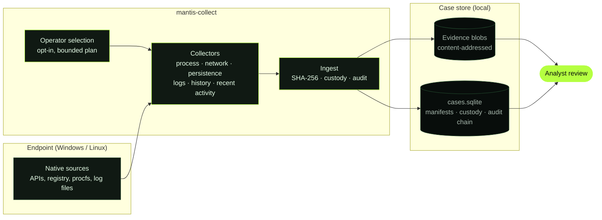

<div align="center">


<br />


<a href="LICENSE.txt"></a>

### Forensic visibility when every artifact matters.

[Overview](#01--overview) · [Capabilities](#02--capabilities) · [Quick Start](#03--quick-start) · [Architecture](#04--architecture) · [Roadmap](#05--project-direction) · [Contributing](#06--contributing)

</div>

---

## `01 // OVERVIEW`

**Mantis** is a forensic evidence collector for Windows and Linux, written in Go. It gathers the host artifacts responders reach for first (processes, network state, persistence, logs, shell history, recent activity) and stores them with integrity metadata, so what you collect can be traced and defended later.

The current generation, **Mantis v2** (`mantis-collect`), is a single static binary with no external tools to download. Every source is opt-in: nothing is read until the operator selects it. Each selected artifact is hashed (SHA-256), stored in a content-addressed evidence store, and recorded in a case database with a custody record and a tamper-evident audit chain. Sources that are unavailable or fail are recorded as gaps rather than silently skipped.

**Who it is for:** incident responders and DFIR analysts who need fast, repeatable triage collection from a live endpoint, with a defensible record of what was collected and how.

> **Current scope:** Mantis collects and preserves artifacts. It does not interpret them, attribute activity, or reason about an incident. Analysis stays with the investigator. Case management, parsing and AI-assisted workflows are listed under [Project Direction](#05--project-direction) as planned work, not as current features.

<div align="center">

**SYSTEMS LEAVE TRACES. MANTIS HELPS YOU SEE THEM.**

</div>

The original v1 tool (a Windows wrapper around Sysinternals and NirSoft utilities) remains in this repository as [`mantis.go`](mantis.go). See [Legacy v1](#legacy-v1).

## `02 // CAPABILITIES`

Capabilities below are what the v2 collector offers today. Use `mantis-collect --list-artifacts` to see what is available on a given host.

### Windows

| Surface | What is collected | Why it matters |
|:--|:--|:--|
| **Processes** | Process snapshot via the Toolhelp32 API | Spot unexpected or masquerading processes and parent/child relationships |
| **Network** | TCP connection table via `GetExtendedTcpTable` | Identify live connections and the processes that own them |
| **Persistence** | `Run` and `RunOnce` autorun registry keys | Find common user and machine persistence points |
| **Event logs** | Exported channels: Application, Security, System, Windows PowerShell, PowerShell/Operational, TaskScheduler/Operational, Defender/Operational, WMI-Activity/Operational, Sysmon/Operational | Build event timelines; channels that do not exist on the host are reported as gaps |
| **PowerShell history** | The current user's PSReadLine `ConsoleHost_history.txt` | Recover interactive commands typed in PowerShell |
| **Recent activity** | UserAssist registry data, `Prefetch` files and the user `Recent` shortcuts | Evidence of programs and files that were executed or opened |
| **Temporary files** | Files from `%SystemRoot%\Temp` | Transient payloads and tool staging |
| **Disks** | Logical volume inventory | Know what storage was present at collection time |

### Linux

| Surface | What is collected | Why it matters |
|:--|:--|:--|
| **Processes** | Process snapshot from `/proc` | Running processes and command lines |
| **Network** | TCP and UDP socket tables from `/proc/net` and a network interface inventory | Sockets and addresses present at collection time |
| **System** | System information, `/etc/hosts`, `/etc/resolv.conf`, `/etc/fstab`, mount info | Host identity and configuration changes |
| **Logs** | `auth.log` or `secure`, `syslog` or `messages`, `audit.log`, `kern.log`, package manager logs (dpkg, dnf, yum, pacman, emerge) | Authentication, system and software-change history; only files present are offered |
| **Zimbra** | Zimbra audit, mailbox and nginx logs when installed | Mail server investigations; never selected automatically |

**Collection limits.** A run is capped by `--max-total-bytes` (default 2 GiB). Directory groups such as Temp, Prefetch and Recent are bounded in file count and depth, and truncation is recorded as a gap. Windows Security log access may require an elevated prompt.

## `03 // QUICK START`

### Prerequisites

- **Go 1.27** or newer to build from source. SQLite is a pure-Go driver, so no C compiler is needed.
- Authorization to collect from the target system.

### Binaries

CI builds `mantis-collect` for Windows (amd64, arm64) and Linux (amd64, arm64, 386, armv7). Release binaries are published on the [Releases](https://github.com/SergioMazariego/Mantis/releases) page from version tags, with a `SHA256SUMS` file, a per-binary SBOM and a build-provenance attestation. The first v2 release has not been published yet; until then, build from source.

### Build

```bash
git clone https://github.com/SergioMazariego/Mantis.git
cd Mantis/v2
go build -trimpath -o mantis-collect ./cmd/mantis-collect
```

On Windows, name the output `mantis-collect.exe`. To cross-compile, set `GOOS` and `GOARCH`, for example `GOOS=linux GOARCH=arm64 CGO_ENABLED=0 go build ...`.

### Run

```bash
mantis-collect --version          # print the build version
mantis-collect --list-artifacts   # list sources available on this host
mantis-collect                    # choose sources: GUI on Windows, terminal menu on Linux
mantis-collect --cli              # force the terminal menu
mantis-collect --artifacts process-snapshot,tcp-connections,powershell-history
mantis-collect --all              # collect every available source (explicit opt-in)
```

Useful options: `--case`, `--tenant`, `--actor` and `--title` label the case; `--max-total-bytes` sets the collection cap.

### Output

Evidence is written to per-user directories rather than next to the executable:

| Data | Location |
|:--|:--|
| Case database (manifests, custody, audit chain) | `<user config dir>/Mantis/cases.sqlite` (`%AppData%\Mantis` on Windows, `~/.config/Mantis` on Linux) |
| Raw evidence blobs, addressed by SHA-256 | `<user cache dir>/Mantis/evidence` (`%LocalAppData%\Mantis` on Windows, `~/.cache/Mantis` on Linux) |

Sources that could not be collected are printed as `PARTIAL` and recorded as gaps in the case.

> **Forensic note:** running a collector on a live system changes it. Document the environment and your procedure, and preserve original evidence and chain-of-custody records according to your own rules.

### Legacy v1

<details>
<summary>The original Windows-only collector (<code>mantis.go</code>)</summary>

<br />

v1 drives external utilities and copies files into an `Artifacts` folder beside the executable. It requires [Sysinternals Suite](https://learn.microsoft.com/en-us/sysinternals/downloads/sysinternals-suite) and [NirSoft LastActivityView](https://www.nirsoft.net/utils/computer_activity_view.html), supplied as `SysinternalsSuite.zip` and `lastactivityview.zip` in the same folder as the executable.

| Output | Source |
|:--|:--|
| Process list | `pslist64` |
| TCP connections | `tcpvcon64` |
| Autoruns | `autorunsc64` |
| Recent activity | `LastActivityView` |
| Disk list | `diskpart` |
| Event logs, PowerShell history, `C:\Windows\Temp` | File copy with `xcopy` |

```powershell
go build -o mantis.exe mantis.go
.\mantis.exe
```

Run it from an elevated prompt. Results are written to `Artifacts\`. v1 is kept for reference; earlier builds remain on the Releases page.

</details>

## `04 // ARCHITECTURE`



Collection is a pipeline from the host to a local, integrity-checked store. Analysis happens after collection, by a person, outside this tool.

## `05 // PROJECT DIRECTION`

Mantis is evolving from a collection utility toward a modern DFIR platform. The split below is deliberate: only what is built and tested counts as available.

### Available now

| Area | Status |
|:--|:--|
| Native collection, no third-party runtime tools | Windows and Linux collectors in `mantis-collect` |
| Evidence integrity | SHA-256 content-addressed storage, acquisition manifests, custody records, audit chain |
| Operator control | Opt-in source selection, bounded plans, gaps recorded explicitly |
| Packaging | Static binaries for Windows and Linux on several architectures, built by CI |

### Planned

| Area | Direction |
|:--|:--|
| Parity with v1 | A LastActivityView-level recent-activity view |
| Extensibility | Pluggable artifact extractors and parsers |
| Case management | Organize evidence, findings and investigators in one place; collaborative investigations |
| Automation | Reproducible, declarative investigation workflows |
| AI assistance | Bring-your-own-key AI integrations and agent-assisted investigation, always under human oversight |

**Design principles:** forensic integrity · repeatability · transparency · modularity · analyst control. No dates are promised for planned items.

## `06 // CONTRIBUTING`

Contributions are welcome.

- **Report a problem or propose a collector:** open an [issue](https://github.com/SergioMazariego/Mantis/issues) with the operating system, architecture, `mantis-collect --version` output and the steps to reproduce.
- **Send a change:** fork, branch from `main`, and open a pull request that explains the change and how you tested it. Use [Conventional Commits](https://www.conventionalcommits.org/) (`feat:`, `fix:`, `docs:`), since release notes are generated from them.
- **Before you push**, from `v2/`: `go vet ./...` and `go test -p 1 ./...`. The `-p 1` keeps memory use low on constrained Windows hosts.
- **Keep the repository public-safe:** enable the guard with `git config core.hooksPath .githooks`. `tools/check_public_tree.py` allows only listed paths and rejects evidence files, credentials and local paths.

### Security

- Use Mantis only on systems you are authorized to examine.
- Never attach real case data, evidence files or credentials to an issue or pull request.
- For a suspected vulnerability, open an issue that states you have a security report, without technical details, and the maintainer will arrange a private channel.

## `07 // LICENSE`

Mantis is released under the [GNU General Public License v3.0](LICENSE.txt). The legacy v1 tool launches third-party utilities that stay under their publishers' terms.

---

<div align="center">


**MANTIS** · Collect · Investigate · Understand

[Repository](https://github.com/SergioMazariego/Mantis) · [Issues](https://github.com/SergioMazariego/Mantis/issues) · [Releases](https://github.com/SergioMazariego/Mantis/releases)

</div>
