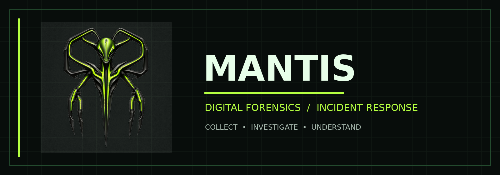
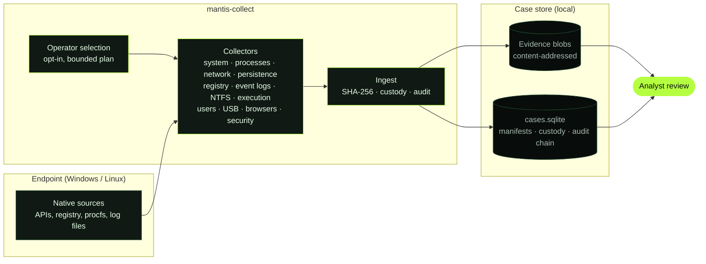

<div align="center">



<br />


<a href="LICENSE.txt"></a>

### Forensic visibility when every artifact matters.

[Overview](#01--overview) · [Capabilities](#02--capabilities) · [Quick Start](#03--quick-start) · [Architecture](#04--architecture) · [Roadmap](#05--project-direction) · [Contributing](#06--contributing)

</div>

---

## `01 // OVERVIEW`

**Mantis** is a forensic evidence collector for Windows and Linux, written in Go. It gathers the host artifacts responders reach for first (processes, network state, persistence, logs, shell history, recent activity) and stores them with integrity metadata, so what you collect can be traced and defended later.

The current generation, **Mantis v2** (`mantis-collect`), is a single static binary with no external tools to download. Every source is opt-in: nothing is read until the operator selects it. Each selected artifact is hashed (SHA-256), stored in a content-addressed evidence store, and recorded in a case database with a custody record and a tamper-evident audit chain. Sources that are unavailable or fail are recorded as gaps rather than silently skipped.

**Who it is for:** incident responders and DFIR analysts who need fast, repeatable triage collection from a live endpoint, with a defensible record of what was collected and how.

> **Current scope:** Mantis collects and preserves artifacts. It does not interpret them, attribute activity, or reason about an incident. Analysis stays with the investigator. Case management, parsing and AI-assisted workflows are listed under [Project Direction](#05--project-direction) as planned work, not as current features.

<div align="center">

**SYSTEMS LEAVE TRACES. MANTIS HELPS YOU SEE THEM.**

</div>

## `02 // CAPABILITIES`

What the v2 collector offers today. Use `mantis-collect --list-artifacts` to see every source, its privilege level, its profiles and whether it is available on the host.

### Acquisition profiles

| Profile | Scope |
|:--|:--|
| **Quick Triage** | System identity, processes, network, persistence, core event logs, key execution artifacts and Defender state. Minutes, small package. |
| **Standard DFIR** | Quick plus registry hives, every exportable event channel, NTFS metadata, user activity, RDP and USB history, browsers and security configuration. |
| **Full Forensic** | Standard plus the remaining sources, within size limits. Sensitive sources (SAM and SECURITY hives, RDP bitmap cache, Recycle Bin content, kernel crash dumps) are only collected here and only with `--confirm-sensitive`. |
| **Custom** | Any individual sources you tick in the window or pass with `--artifacts`. |

Nothing is collected unless you select it.

### Windows

| Category | What is collected | Why it matters |
|:--|:--|:--|
| **System** | OS and host identity, time zone and clock offset, physical disks (with offline, read-only and dynamic state), partitions and volumes, installed software, services and loaded drivers | Establish what machine and configuration the evidence came from |
| **Processes** | Detailed snapshot with command lines, parents, owners and image hashes; embedded signature state; handle counts; virtual memory region map (metadata only); performance counters (base priority, CPU times, virtual and pool memory, faults, I/O) and per-thread state | Spot masquerading processes and injection candidates |
| **Network** | TCP and UDP tables with owning process, interfaces, DNS cache, neighbor table and routes, proxy settings, firewall configuration and network profiles | Live connections and the processes behind them |
| **Persistence** | Run and RunOnce keys, scheduled tasks and task cache, services, startup folders, WMI repository, IFEO, COM and Active Setup keys, Winsock providers, logon and boot keys, shell extensions, credential providers, protocol and shell handlers, DirectShow filters, BITS jobs; every autostart entry is also resolved to its executable with MD5/SHA-1/SHA-256, Authenticode, company, description and version | The common footholds, in one pass |
| **Registry** | SYSTEM, SOFTWARE and DEFAULT hives, per-user NTUSER.DAT and UsrClass.dat, transaction logs, with a read-only snapshot fallback for locked hives | Offline analysis of configuration, accounts and execution state |
| **Event logs** | Every exportable channel as EVTX, plus channel configuration and archived logs; in Full, a byte-for-byte copy of every `.evtx` file as it is on disk; analytic and debug channels that cannot be exported are listed as one explicit gap | Timelines for logons, process creation, PowerShell, tasks and more |
| **NTFS** | `$MFT`, `$LogFile`, `$UsnJrnl`, volume metadata, Zone.Identifier streams, alternate data stream inventory, Recycle Bin metadata, read from the raw volume | File-system activity that the live file API hides |
| **Execution** | Prefetch, Amcache, ShimCache, BAM/DAM, UserAssist, SRUM, Windows Error Reporting, compatibility assistant, PowerShell history; kernel crash dumps in Full | Evidence of programs that ran |
| **Users** | Local accounts and groups, profiles, recent files, jump lists, timeline activity, Explorer activity, package manager data | Who was on the host and what they touched |
| **Remote access** | Logon sessions, RDP client history and server configuration, SMB shares and sessions, SMB and WinRM configuration | Lateral movement and remote administration traces |
| **USB** | Device history from the registry, setup logs and user mount points | Removable media that touched the host |
| **Browsers** | History, bookmarks, extensions and configuration for Chromium-based browsers and Firefox | Web activity without touching credentials |
| **Security** | Defender configuration, exclusions and detection history, audit policy, firewall logs, event-log configuration | Defensive posture and tampering signals |
| **Group policy** | Applied policy registry state and local policy files | What configuration was being enforced |
| **Shadow copies** | Read-only enumeration of existing snapshots | Know what historical copies exist |

**Run as administrator** for a complete acquisition. Without elevation, protected sources are reported as `access_denied` instead of being skipped silently. Hives and raw NTFS artifacts need it.

### Linux

| Surface | What is collected | Why it matters |
|:--|:--|:--|
| **Processes** | Process snapshot from `/proc` | Running processes and command lines |
| **Network** | TCP and UDP socket tables from `/proc/net` and a network interface inventory | Sockets and addresses present at collection time |
| **System** | System information, `/etc/hosts`, `/etc/resolv.conf`, `/etc/fstab`, mount info | Host identity and configuration changes |
| **Logs** | `auth.log` or `secure`, `syslog` or `messages`, `audit.log`, `kern.log`, package manager logs | Authentication, system and software-change history; only files present are offered |
| **Zimbra** | Zimbra audit, mailbox and nginx logs when installed | Mail server investigations; never selected automatically |

### Safety by design

- **Read-only.** No registry writes, no hive loading, no creating or deleting shadow copies, no changes to the host.
- **Credentials stay out.** Browser passwords, cookies and tokens, Wi-Fi key material and `lsass` memory are never collected. Values whose name suggests a secret keep name, type and size but not content.
- **Honest outcomes.** Every source ends as `collected`, `collected_with_warnings`, `empty`, `not_present`, `not_supported`, `access_denied`, `failed` or `cancelled`. A finished run never claims a complete endpoint collection.
- **Verified package.** The evidence package carries a manifest, per-source status, checksums and a verification result that is re-read from disk.
- **No network.** Nothing is uploaded; everything stays in the output folder you choose.

**Collection limits.** A run is capped by `--max-total-bytes` (default depends on the profile: 2 GiB quick, 16 GiB standard, 64 GiB full). Directory groups are bounded in file count and depth, and any truncation is recorded as a gap.

### Validation status

The Windows collectors run in CI on Windows Server 2022 and 2025 and on Windows 11 arm64 runners, and were exercised end to end, including the window and a standard-user run, in a clean Windows 11 environment. Every run builds a package and re-verifies it against planted test artifacts, including real Firefox history (Chromium browsers are checked structurally: profile present and History database collected). Raw NTFS reads are exercised on the Server and Windows 11 arm64 runners. Not yet exercised: physical hosts and a full Windows 11 amd64 client (the test sandbox refuses raw volume reads).

## `03 // QUICK START`

### Prerequisites

- **Go 1.27** or newer to build from source. SQLite is a pure-Go driver, so no C compiler is needed.
- Authorization to collect from the target system.

### Binaries

Release binaries for Windows (amd64, arm64) and Linux (amd64, arm64, 386, armv7) are on the [Releases](https://github.com/SergioMazariego/Mantis/releases) page, built by CI from version tags. Each release carries a `SHA256SUMS` file, a per-binary SBOM and a build-provenance attestation (`gh attestation verify <file> --repo SergioMazariego/Mantis`). Check the checksum before running a binary.

The binaries are not code-signed yet. Because the collector uses techniques shared with forensic and attack tooling (raw volume reads, hive export, backup privileges), endpoint protection may flag or block them: sign and allowlist them for authorized use.

### Build

```bash
git clone https://github.com/SergioMazariego/Mantis.git
cd Mantis/v2
go build -trimpath -o mantis-collect ./cmd/mantis-collect
```

On Windows, name the output `mantis-collect.exe`. To cross-compile, set `GOOS` and `GOARCH`, for example `GOOS=linux GOARCH=arm64 CGO_ENABLED=0 go build ...`. Process memory dumps are compiled out of the default binary; build with `-tags memdump` for authorized use.

### Run

```bash
mantis-collect --version                          # print the build version
mantis-collect --list-artifacts                   # list sources: category, privilege, profiles, availability
mantis-collect                                    # choose a profile or sources: window on Windows, menu on Linux
mantis-collect --profile standard                 # quick, standard or full, without prompts
mantis-collect --profile full --confirm-sensitive # include sensitive sources, explicitly approved
mantis-collect --artifacts process-snapshot,tcp-connections
mantis-collect --output D:\evidence               # package location; must be NTFS on Windows
mantis-collect --profile standard --temp-types executable,library,script   # Windows\Temp: only these kinds of file
mantis-collect --profile standard --temp-ext exe,dll,ps1 --temp-modified-days 30
```

**Narrowing the Windows Temp collection.** By default `C:\Windows\Temp` is copied in full (up to 8000 files, depth 6, 128 MiB per file). To bring back only what matters for malware triage, combine `--temp-ext` (extensions), `--temp-types` (`executable`, `library`, `script`, `archive`, `document`, `shortcut`), `--temp-max-file-mb`, `--temp-modified-days`, `--temp-max-files` and `--temp-depth`. Types match by name **and** by the first bytes of the file, so a payload renamed to `.tmp` or `.dat` is still found. The package states the filter and how many files were left out on purpose.

Every copied file and exported event log records the source file's **creation, last access and last write times** (`source_created_utc`, `source_accessed_utc`, `source_modified_utc`) in its manifest notes. They are read before the content, with a handle that cannot alter them.

Useful options: `--case`, `--tenant`, `--actor` and `--title` label the case; `--max-total-bytes` sets the collection cap; `--cli` forces the terminal menu; `--force` continues when free space looks short.

On Windows the default is a dark window with profile chips, search, a category sidebar, privilege and size columns, a live execution screen with per-source status, safe cancellation (evidence already acquired is kept) and a final summary.

### Output

Each run writes one self-describing evidence package:

```
Mantis-<case>-<host>-<UTC>/
  manifest.json  acquisition-report.json  acquisition-errors.json  checksums.sha256  verification.json
  system/  registry/  persistence/  processes/  network/  eventlogs/  ntfs/  execution/  users/
  remote-access/  usb/  browsers/  security/  group-policy/  shadow-copies/  memory/
```

Raw artifacts keep their original path. The manifest records the original path, size, SHA-256 and the method actually used (direct shared read, raw NTFS read, registry hive save, event-log export, API snapshot). The case database and content-addressed blobs live in `.mantis` inside the output folder.

Sources that could not be collected are recorded as gaps with the reason, never omitted.

> **Forensic note:** running a collector on a live system changes it. Document the environment and your procedure, and preserve original evidence and chain-of-custody records according to your own rules.

## `04 // ARCHITECTURE`



Collection is a pipeline from the host to a local, integrity-checked store. Analysis happens after collection, by a person, outside this tool.

## `05 // PROJECT DIRECTION`

Mantis is evolving from a collection utility toward a modern DFIR platform. The split below is deliberate: only what is built and tested counts as available.

### Available now

| Area | Status |
|:--|:--|
| Native collection, no third-party runtime tools | Windows and Linux collectors in `mantis-collect` |
| Evidence integrity | SHA-256 content-addressed storage, acquisition manifests, custody records, audit chain |
| Operator control | Opt-in source selection, bounded plans, gaps recorded explicitly |
| Evidence package | Portable manifest, per-source status, checksums and a verification result re-read from disk |
| Acquisition profiles | Quick, Standard and Full, with sensitive sources opt-in |
| Packaging | Static binaries for Windows and Linux on several architectures, built and attested by CI |
| Validation | Windows collectors exercised in CI on Windows Server and Windows 11 arm64 runners, with planted test artifacts |

### Planned

| Area | Direction |
|:--|:--|
| Validation | A full Windows 11 amd64 client host, history content of Chromium browsers, code signing |
| Extensibility | Pluggable artifact extractors and parsers |
| Case management | Organize evidence, findings and investigators in one place; collaborative investigations |
| Automation | Reproducible, declarative investigation workflows |
| AI assistance | Bring-your-own-key AI integrations and agent-assisted investigation, always under human oversight |

**Design principles:** forensic integrity · repeatability · transparency · modularity · analyst control. No dates are promised for planned items.

## `06 // CONTRIBUTING`

Contributions are welcome.

- **Report a problem or propose a collector:** open an [issue](https://github.com/SergioMazariego/Mantis/issues) with the operating system, architecture, `mantis-collect --version` output and the steps to reproduce.
- **Send a change:** fork, branch from `main`, and open a pull request that explains the change and how you tested it. Use [Conventional Commits](https://www.conventionalcommits.org/) (`feat:`, `fix:`, `docs:`), since release notes are generated from them.
- **Before you push**, from `v2/`: `go vet ./...` and `go test -p 1 ./...`. The `-p 1` keeps memory use low on constrained Windows hosts.
- **Keep the repository public-safe:** enable the guard with `git config core.hooksPath .githooks`. `tools/check_public_tree.py` allows only listed paths and rejects evidence files, credentials and local paths. The Windows validation workflow (`.github/workflows/validate-windows.yml`, scripts in `tools/validate/`) runs on pull requests that touch `v2/`.

### Security

- Use Mantis only on systems you are authorized to examine.
- Never attach real case data, evidence files or credentials to an issue or pull request.
- For a suspected vulnerability, open an issue that states you have a security report, without technical details, and the maintainer will arrange a private channel.

## `07 // LICENSE`

Mantis is released under the [GNU General Public License v3.0](LICENSE.txt).

---

<div align="center">


**MANTIS** · Collect · Investigate · Understand

[Repository](https://github.com/SergioMazariego/Mantis) · [Issues](https://github.com/SergioMazariego/Mantis/issues) · [Releases](https://github.com/SergioMazariego/Mantis/releases)

</div>
